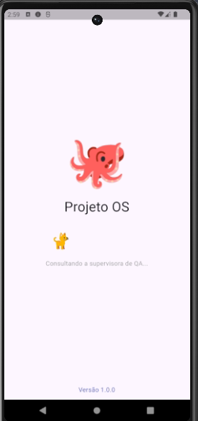
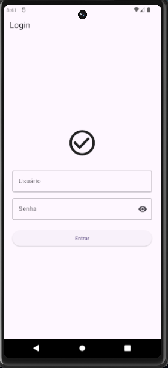
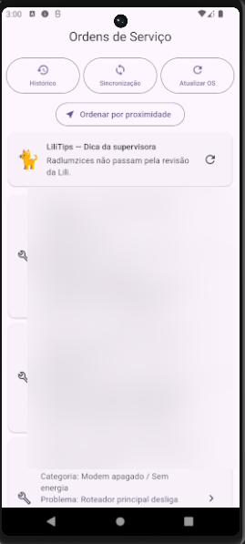
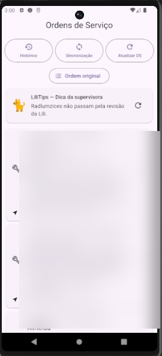
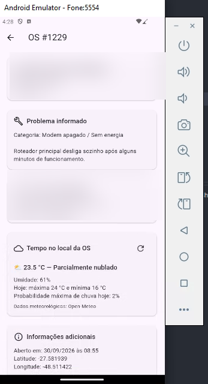
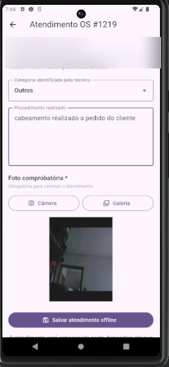
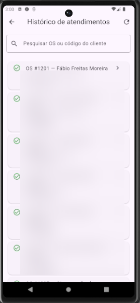
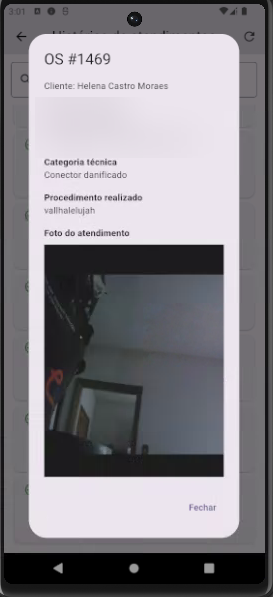
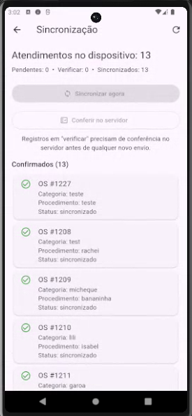

# Projeto OS — Clayton 🐙

**Aplicativo Flutter para gestão de ordens de serviço e atendimentos técnicos em campo.**  
**Versão:** 1.0.0 · **Projeto avaliativo:** SENAI / LAB365 · **Status:** entrega acadêmica

[Apresentação institucional do Clayton](https://eribertotorres.com.br/projetos/clayton/) · [Roadmap de evolução](docs/ROADMAP.md)

## Sobre o projeto

O **Projeto OS**, apelidado de **Clayton**, foi desenvolvido para apoiar técnicos de provedores de internet no atendimento a ordens de serviço. A proposta é reunir informações do chamado, localização, condições do tempo e registro de procedimentos em um único aplicativo, inclusive quando a conexão com a internet não está disponível.

O projeto integra a **API ISP Conecta**, oferecida para a atividade acadêmica, a um banco local **SQLite**. Atendimentos realizados sem conexão são preservados no dispositivo e podem ser sincronizados posteriormente.

## Por que Clayton, Lili e LiliTips?

**Clayton 🐙** é uma brincadeira inspirada em **Cthulhu**, personagem criado por H. P. Lovecraft. Segundo a história que deu origem ao nome, um amigo do professor tinha dificuldade para pronunciar “Cthulhu” e passou a chamá-lo de “Clayton”. A brincadeira acabou batizando o mascote do aplicativo. A figura do polvo ganhou uma representação amigável, em contraste com sua inspiração no horror cósmico.

**Lili 🐈** é a gata do desenvolvedor e uma participante inesperada da jornada: no início dos trabalhos, derrubou um copo de Coca-Cola. Mais tarde, sofreu um acidente e se machucou. Felizmente, sobreviveu. Sua presença na animação de abertura e nas mensagens do aplicativo é uma homenagem em vida. O desejo do desenvolvedor era manter sua lembrança representada no projeto, independentemente do desfecho do acidente.

O **LiliTips** apresenta frases e recomendações curtas inspiradas em experiências pessoais e profissionais, dando identidade à interface e incentivando atenção e cuidado durante o trabalho.

## Funcionalidades da v1.0.0

- **Autenticação:** login integrado à API, com recuperação da sessão armazenada.
- **Ordens de serviço:** consulta e atualização de chamados, com dados do problema e do local de atendimento.
- **Localização:** distância aproximada e ordenação de OS por proximidade.
- **Clima na OS:** exibição de informações meteorológicas fornecidas pelo [Open-Meteo](https://open-meteo.com/), úteis ao planejamento do trabalho de campo.
- **Registro de atendimento:** classificação técnica, descrição do procedimento e fotografia comprobatória.
- **Persistência offline:** armazenamento local dos atendimentos, com registro da data/hora de conclusão.
- **Sincronização:** envio posterior dos registros ao servidor e conferência de resultados incertos para reduzir reenvios duplicados.
- **Histórico:** consulta e pesquisa de atendimentos, incluindo detalhes e fotografias quando disponíveis.
- **LiliTips:** mensagens rotativas na interface principal.

> **Nota:** alertas inteligentes de chuva, checklists operacionais, API de homenagens e logout explícito são **propostas futuras**, não funcionalidades entregues na v1.0.0.

## Telas do aplicativo

| Inicialização | Autenticação | Ordens de serviço |
|:--:|:--:|:--:|
|  |  |  |
| **Splash** | **Login** | **Home** |

| Proximidade | Clima no atendimento | Registro offline |
|:--:|:--:|:--:|
|  |  |  |
| **Geolocalização** | **Detalhes e Open-Meteo** | **Atendimento com foto** |

| Histórico | Evidência fotográfica | Sincronização |
|:--:|:--:|:--:|
|  |  |  |
| **Histórico** | **Detalhes e evidência** | **Sincronização** |

*As capturas foram tratadas para reduzir a exposição de identificadores de clientes. Os textos e imagens dos atendimentos retratam o ambiente de demonstração; revise-os antes de publicar o repositório.*

## Como funciona o modo offline

1. Quando há internet, os chamados são consultados na API e armazenados localmente.
2. Quando a rede falha, chamados previamente armazenados podem ser exibidos a partir do SQLite.
3. O técnico registra o atendimento e anexa a fotografia; os dados são guardados no dispositivo.
4. A OS atendida deixa de aparecer entre os chamados abertos do aplicativo e passa a constar no histórico local.
5. Assim que houver conexão, a sincronização envia os registros pendentes. Situações de confirmação incerta podem exigir conferência no servidor antes de um novo envio.

A **data de conclusão** corresponde ao momento registrado pelo dispositivo, não ao momento posterior de sincronização.

## Tecnologias e arquitetura

| Componente | Uso |
|---|---|
| **Flutter / Dart** | Aplicativo Android e interface |
| **MVVM (organização inspirada no padrão)** | Separação entre views, estado/apresentação e acesso a dados |
| **SQLite (`sqflite`)** | Cache de OS e registros de atendimentos pendentes |
| **HTTP / API REST** | Autenticação, consulta de chamados, envio e histórico |
| **HMAC-SHA256 e Bearer Token** | Autenticação conforme contrato da API acadêmica |
| **Geolocalização** | Distâncias e ordenação por proximidade |
| **Câmera / galeria** | Evidência fotográfica do serviço |
| **Open-Meteo** | Dados meteorológicos do local associado à OS |

O código separa **interfaces (views)**, **lógica de apresentação (viewmodels)** e **serviços/repositórios de dados**. A preocupação central foi manter o trabalho em campo utilizável mesmo com conectividade instável.

## Executar localmente

**Requisitos:** Flutter SDK, Android SDK, dispositivo Android ou emulador e credenciais válidas do ambiente acadêmico.

```bash
git clone https://github.com/eribertotorres/projeto_os.git
cd projeto_os
flutter pub get
flutter run
```

As funcionalidades autenticadas dependem da disponibilidade da API ISP Conecta e das credenciais de acesso. **Não publique usuários, senhas, tokens ou segredos de integração no GitHub.**

## Testes e validação

Na preparação da versão 1.0.0, foram executadas as verificações abaixo:

| Verificação | Resultado |
|---|---:|
| Testes do ViewModel de chamados | 3 aprovados |
| Testes de persistência SQLite | 5 aprovados |
| Testes de widget da Home | 2 aprovados |
| **Total (`flutter test`)** | **10 aprovados** |
| `flutter analyze` | **Nenhum problema encontrado** |

```bash
flutter analyze
flutter test
```

Também foram exercitados os fluxos de login, listagem online/offline, consulta do chamado, localização, registro com foto, histórico e sincronização. **Os dez testes não significam cobertura automatizada integral do sistema.**

## Desenvolvimento e decisões

O trabalho foi conduzido incrementalmente, com backlog e organização inspirada em Scrum, controle de versões Git e branches de funcionalidade (`feature/*`), integração (`develop`) e versão estável (`main`). Os principais desafios envolveram persistência SQLite, atualizações de esquema, diferenciação entre registros locais e remotos, tratamento de falhas de conexão e prevenção de duplicações no envio.

O clima foi incluído por uma razão prática: experiências pessoais e profissionais mostraram que as condições meteorológicas podem interferir no deslocamento e no atendimento do técnico. Na v1.0.0, a informação é apresentada ao usuário; avisos proativos fazem parte das evoluções propostas.

## Evolução do produto

O projeto possui um [**roadmap institucional**](docs/ROADMAP.md), separado das funcionalidades implementadas, que registra ideias como homenagens dinâmicas, LiliTips contextual, checklist por serviço, logout e melhorias visuais do login. Essas propostas **não têm prazo de entrega nem integram a versão acadêmica atual**.

## Demonstração em vídeo

**Vídeo demonstrativo da versão 1.0.0:** [Assistir no YouTube](https://youtu.be/-OxLzNRcX9c)

## Autoria e agradecimentos

- **Eriberto Torres de Oliveira:** autoria, desenvolvimento, definição e validação do produto, testes e entrega.
- **Órion — ChatGPT (OpenAI):** apoio técnico colaborativo em planejamento, revisão, depuração, testes e documentação, sob direção do autor.
- **Professor Rafael Aguiar:** orientação acadêmica e definição da atividade.

Projeto desenvolvido no contexto da formação mobile com Flutter do **SENAI / LAB365**. A autoria e as decisões finais são de responsabilidade do desenvolvedor.

Agradecimento especial à **Lili**, cuja presença durante o desenvolvimento se tornou uma parte afetiva da identidade do projeto.

---

*Clayton 🐙 — um polvo inspirado em Cthulhu, construído para apoiar quem trabalha em campo e acompanhado de uma homenagem muito real à Lili 🐈.*
